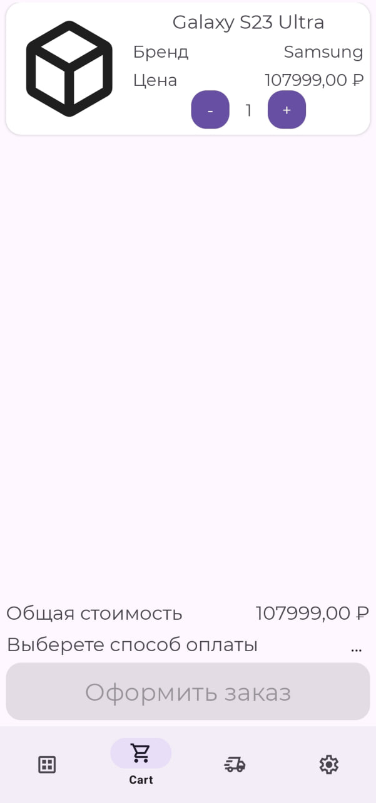
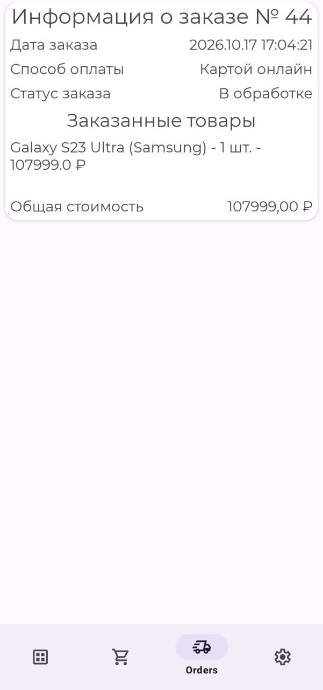

# Интернет-магазин (Android-приложение)

Учебный проект интернет-магазина, разработанный в рамках курсовой работы по дисциплине «Разработка мобильных приложений». Цель проекта — отработать навыки проектирования мобильного Android-приложения, работы со слоистой архитектурой и интеграции с Backend-as-a-Service

## О проекте

Приложение реализует базовый функционал интернет-магазина: просмотр каталога товаров, карточка товара, работа с корзиной, оформление заказа, авторизация и профиль пользователя. Данные хранятся и синхронизируются через Supabase

## Функционал

- Регистрация и авторизация пользователя (Supabase Auth)
- Каталог категорий и товаров
- Детальная карточка товара
- Корзина: добавление/удаление товара, изменение количества
- Оформление заказа
- Личный кабинет / профиль пользователя
- Навигация между экранами
- Загрузка данных с удалённого backend

## Чему я научился

В ходе работы над этим проектом я закрепил и применил на практике следующие навыки:

- **Проектирование структуры БД** для мобильного приложения под конкретный функционал (товары, категории, корзина, заказы, пользователи)
- **Принцип Data–Domain–Presentation** — осознанное разделение ответственности между слоями и выстраивание зависимостей
- **MVVM как реализация разделения Data-Domain-Presentation** — понимание ролей: `View` (UI, отображение), `ViewModel` (управление состоянием, бизнес-взаимодействие), `Model` (данные и правила доступа к ним)
- **Работа с Backend-as-a-Service (Supabase)** — настройка и интеграция, работа с авторизацией, чтение/запись данных через PostgREST
- **Специфика Android-разработки** — XML-верстка, ViewBinding, Navigation Component, жизненный цикл компонентов, ресурсы
- **Работа с типичными Android-библиотеками** — Navigation, RecyclerView, Lifecycle, Coroutines, Koin
- **Понимание границ слоёв** — на практике увидел разницу между "работа с данными" и "бизнес-правилами". Осознал, что корректнее выносить бизнес-логику в **UseCase**, а не оставлять её целиком в **Repository** (что частично присутствует в текущей версии проекта)

## Демо

- Демонстрационное видео: [`coursework/Интернет Магазин демо-видео.mp4`](coursework/Интернет%20Магазин%20демо-видео.mp4)
- Текст и презентация курсовой: [`coursework/`](coursework/)

## Экраны: активности

|Активность входа|Активность регистрации|
|---|---|
|||

## Экраны: фрагменты

|Каталог товаров|Корзина|Заказы|Настройки|
|---|---|---|---|
|||||

## Стек технологий

- **Язык:** Kotlin
- **UI:** XML-разметка, ViewBinding
- **Архитектура:** MVVM + Data–Domain–Presentation (Clean Architecture-подход)
- **Dependency Injection:** Koin
- **Навигация:** Navigation Component
- **Асинхронность:** Kotlin Coroutines + Flow
- **Жизненный цикл:** AndroidX Lifecycle (ViewModel, LiveData)
- **Сеть/Backend-as-a-Service:** Supabase Kotlin SDK (Auth, PostgREST, Realtime), Ktor Client + OkHttp
- **UI-компоненты:** Fragment, RecyclerView, CardView, ConstraintLayout
- **Прочее:** kotlinx-datetime

## Архитектура

Проект построен с разделением на слои:

- **`data/`** — работа с источниками данных (SupabaseDataSource), DTO-модели, реализации репозиториев (`data/repository/*`). Отвечает за преобразование данных из сетевого формата в доменные сущности
- **`domain/`** — бизнес-сущности (`entities`), интерфейсы репозиториев (`domain/repository`), use-case'ы (`domain/usecases`). Содержит контракт взаимодействия слоёв
- **`views/`** (presentation-слой) — UI-слой в виде Fragment/Activity, `ViewModel`, адаптеры. View отображает состояние, ViewModel обрабатывает действия пользователя и взаимодействует с use-case'ами
- **`di/`** — модули Koin для связывания зависимостей
- **`models/`, `utils/`** — вспомогательные типы и утилиты

## Известные ограничения

Данный проект был первым крупным опытом применения слоистой архитектуры. В силу учебных целей и первого подхода:
- **UseCase'ы преимущественно тонкие** — в основном делегируют вызов в репозиторий. Часть бизнес-правил реализована непосредственно в `RepositoryImpl`
- **Есть пространство для рефакторинга** — в будущих проектах планирую перенести осмысленную бизнес-логику из репозиториев в соответствующие use-case'ы для более явного соблюдения принципов чистой архитектуры
